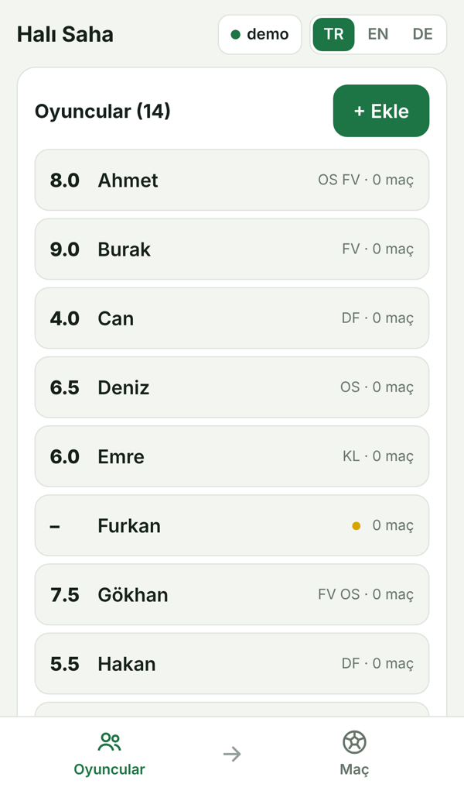
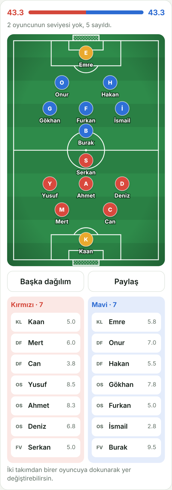

# pickup-football-teams

A small, phone-first helper for splitting a group of friends into **fair teams** for small-sided football (6v6, 7v7, 8v8 …). Live at **[anilcanpolat.com/football](https://anilcanpolat.com/football/)**.

<p>
  
  
</p>

**Languages:** Türkçe (default), English, Deutsch

## How it works

1. **Players:** add everyone once. Only the name is required. Level (1–10), positions (GK / DEF / MID / FWD) and fitness (1–5) are optional but make the split fairer; missing levels count as 5.
2. **Match:** tick who is playing today and tap *Build teams*. The balancer
   - equalises total strength (level + small fitness bonus + optional recent form),
   - puts one keeper on each side when possible, otherwise uses a **rotating keeper**,
   - spreads defenders, midfielders and forwards,
   - keeps the two strongest players apart,
   - can avoid repeating last match's teams.

   It is **deterministic**: the same selection always gives the same teams. *Another split* shows the next-best option, and you can swap two players by tapping them.
3. **Result:** enter the score after the game; play counts and form update automatically.

## Accounts

There is no password. **The name is the key**: signing in with the same name on any phone loads the same list, so pick something others won't guess (e.g. `anil-halisaha-34`). Without signing in nothing is stored, and the list is gone on reload.

## Structure

```
web/index.html             single-file app (HTML + CSS + JS, no dependencies)
api/server.py              storage API, Python standard library only
api/docker-compose.yml     runs the API as container "football-api" on network "football-net"
deploy/nginx-location.conf nginx block that forwards /football/api/ to the API
```

The API stores one JSON file per name in `api/data/` and keeps older copies in `api/data/versions/<name>/` (at most one every 10 minutes, last 50).

| Method | Path | |
|---|---|---|
| `GET` | `/football/api/data/<name>` | saved list, `404` if none |
| `PUT` | `/football/api/data/<name>` | save list (max 256 KB) |
| `GET` | `/football/api/health` | `{"ok":true}` |

## Self-hosting

```bash
# 1. API
cd api
mkdir -p data
docker compose up -d

# 2. web page: serve web/index.html at /football/ from any nginx
cp web/index.html /var/www/<site>/football/index.html

# 3. connect nginx to the API
docker network connect football-net <nginx-container>
# add deploy/nginx-location.conf inside the server { } block, then:
docker exec <nginx-container> nginx -t && docker exec <nginx-container> nginx -s reload
```

Open `web/index.html` directly in a browser to try it without the API (guest mode).

---

### Türkçe

Halı saha için arkadaşları **dengeli takımlara** bölen, telefona göre tasarlanmış küçük bir yardımcı. Önce **Oyuncular** sekmesinde herkesi ekle (sadece isim zorunlu; seviye, mevki ve kondisyon dengeyi iyileştirir), sonra **Maç** sekmesinde gelenleri seç ve *Takımları kur*. Kaleci yoksa *Kaleci sırayla* seçeneği var. Giriş için şifre yok: **isim anahtar gibidir**, aynı isimle her telefondan aynı liste gelir. Girişsiz kullanırsan sayfa yenilenince liste silinir.

### Deutsch

Ein kleiner, fürs Handy gebauter Helfer, der Freunde für Kleinfeldfußball in **faire Teams** aufteilt. Zuerst unter **Spieler** alle anlegen (nur der Name ist Pflicht; Stärke, Position und Fitness machen die Teams fairer), dann unter **Spiel** die Anwesenden wählen und *Teams bilden*. Ohne festen Torwart gibt es die Option *Torwart wechselt*. Es gibt kein Passwort: **Der Name ist der Schlüssel**, mit demselben Namen erscheint auf jedem Handy dieselbe Liste. Ohne Anmeldung wird die Liste beim Neuladen gelöscht.
